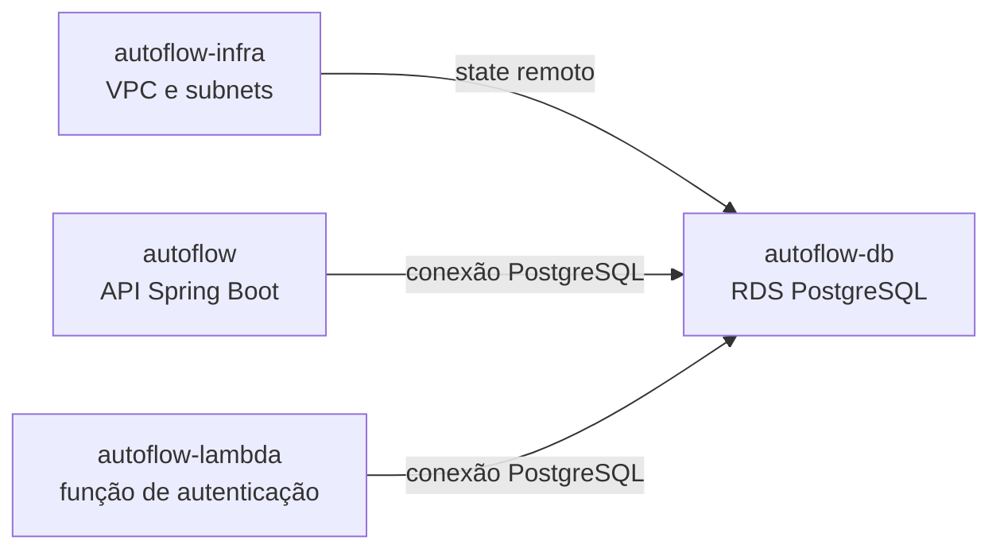

# AutoFlow — Infraestrutura do RDS

Este repositório declara recursos Terraform para o PostgreSQL gerenciado do AutoFlow na AWS. O código é configuração desejada e não comprova que o RDS ou os recursos de rede estejam implantados.

## Responsabilidade e dependências

O root `infra/` declara uma instância Amazon RDS PostgreSQL 17, subnet group e Security Groups. Ele consome saídas do state Terraform da infraestrutura compartilhada, mantida em `autoflow-infra`. A aplicação Spring Boot e a Lambda usam o banco conforme suas configurações.



O diagrama representa dependências declaradas, não conectividade ou implantação confirmada.

## Esquema, migrations e seeds

O modelo relacional implementado é versionado pelo Flyway na aplicação `autoflow`, em
[`backend/src/main/resources/db/migration`](../autoflow/backend/src/main/resources/db/migration/). As migrations
definem usuários, clientes, veículos, ordens de serviço, serviços, peças/insumos e entidades relacionadas; constraints
e evolução de schema devem ser lidas nas migrations. O backend executa Flyway conforme sua configuração. Este repositório
provisiona RDS e não mantém uma cópia independente do schema.

A migration V49 deste repositório está em [`migrations/V49__corrigir_documentos_seeds_demo.sql`](migrations/V49__corrigir_documentos_seeds_demo.sql).
Há também uma migration V49 da aplicação em [`autoflow/backend/src/main/resources/db/migration/V49__corrigir_documentos_seeds_demo.sql`](../autoflow/backend/src/main/resources/db/migration/V49__corrigir_documentos_seeds_demo.sql),
e a aplicação possui a V50 [`V50__corrigir_documentos_staff_demo.sql`](../autoflow/backend/src/main/resources/db/migration/V50__corrigir_documentos_staff_demo.sql),
que corrige documentos sintéticos de usuários demonstrativos não-clientes. São repositórios/localizações distintos;
`autoflow-db` não contém V50 em `migrations/`. O checkpoint anterior reportou 47 migrations Flyway validadas,
mas não comprova se V49/V50 foram aplicadas posteriormente no RDS. Consulte [detalhes dos seeds](docs/seeds-demonstracao.md).

## Configuração Terraform observada

| Propriedade | Valor declarado |
|---|---|
| Engine e versão | PostgreSQL 17 |
| Classe | `db.t3.micro` |
| Armazenamento inicial | 20 GB |
| Nome do banco | `autoflow_db` |
| Porta | 5432 |
| Subnets | IDs privados lidos do state de `autoflow-infra` |
| Acesso público | `publicly_accessible = false` |
| Criptografia do storage | `storage_encrypted = true` |
| Snapshot final | Obrigatório (`skip_final_snapshot = false`) |
| Proteção contra remoção | Ativada (`deletion_protection = true`) |
| Enhanced Monitoring | Desativado (`monitoring_interval = 0`) |

A configuração Terraform atual declara acesso privado, storage criptografado, snapshot final obrigatório e proteção contra remoção. Esses são valores desejados no código e não evidência do estado efetivo do RDS. O checkpoint de homologação referido abaixo documenta observações pontuais de runtime, sem comprovar configuração atual após aquela data.

## Estado e pré-requisitos

O root declara backend S3 por meio de `infra/backend.tf` e consome o state da infraestrutura em `infra/rds-postgresql.tf`. Antes de qualquer inicialização ou plano remoto, confirme bucket, key, responsabilidade e state autoritativo com os responsáveis. Não inicialize um state vazio sobre recursos que possam existir.

O bucket/key do backend são parâmetros externos, não arquivos de exemplo versionados. Para uso local, configure `AWS_PROFILE`, `AWS_REGION`, `AWS_EXPECTED_ACCOUNT_ID`, `TF_VAR_aws_profile`, `TF_VAR_aws_allowed_account_ids` (JSON de uma lista), `TF_VAR_terraform_state_bucket`, `TF_VAR_infra_state_key` e os inputs de banco por variáveis de ambiente locais ou por mecanismo seguro. Valide a identidade com `scripts/verify_aws_account.py` antes de acessar AWS. O `terraform init` recebe `-backend-config` para bucket, key, região, `encrypt=true` e `use_lockfile=true`.

O AWS Academy Learner Lab pode restringir políticas, boundaries, SCPs, contexto de `iam:PassRole`, quotas e duração da sessão. A saída `allowed`/`implicitDeny` de `simulate-principal-policy` é apenas uma simulação e **não garante autorização efetiva**. Inventários também se limitam à conta, região e permissões consultadas. A homologação observada do API Gateway/RDS está registrada no [checkpoint de migração](../autoflow-infra/docs/api-gateway/progresso.md); ela não autoriza alterações futuras no banco.

## Comandos Terraform

Os comandos abaixo são referências de fluxo. Execute-os somente com state, conta, perfil AWS e autorização previamente confirmados:

```bash
terraform init -backend=false -input=false
terraform fmt -check -recursive
terraform validate
```

Para usar backend remoto, somente após reconciliar state, passe os parâmetros aprovados em `terraform init -reconfigure -backend-config=...`. `plan`/`apply` não fazem parte da validação estática; `apply` altera recursos AWS e exige autorização explícita e revisão do plano. A configuração atual ativa proteção contra remoção e exige snapshot final; operações destrutivas continuam sujeitas a plano de recuperação aprovado.

## CI/CD

Consulte o [catálogo de variables e secrets](docs/variables-and-secrets.md) e o [histórico](docs/variables-changelog.md) para configurar GitHub Actions e inputs Terraform.

O workflow `.github/workflows/pipeline.yml` executa CI em PRs e pushes para `develop`/`main` (guard de conta, `fmt`,
`init -backend=false` e `validate`). CD somente por `workflow_dispatch` em `develop`, no Environment `homolog`: valida
conta e states, cria Plan e bloqueia destruições/substituições sem autorização explícita. Apply depende do input `apply`
e de `TERRAFORM_APPLY_APPROVAL_CONFIGURED=true`; esse guard orienta configurar Required reviewers, mas não comprova
que estejam efetivamente configurados. A execução do deploy pelo GitHub Actions não foi comprovada por este checkout.

O workflow referencia Secrets `AWS_ACCESS_KEY_ID`, `AWS_SECRET_ACCESS_KEY`, `AWS_SESSION_TOKEN`, `DATABASE_USERNAME`
e `DATABASE_PASSWORD`. Variables incluem `AWS_REGION`, `AWS_EXPECTED_ACCOUNT_ID`, `AWS_TERRAFORM_STATE_BUCKET`,
`AWS_TF_STATE_KEY`, `AWS_INFRA_STATE_KEY` e `TERRAFORM_APPLY_APPROVAL_CONFIGURED`. Os valores devem ser cadastrados
no GitHub, nunca neste README.

## Fontes

- [`infra/rds-postgresql.tf`](infra/rds-postgresql.tf)
- [`infra/sg.tf`](infra/sg.tf)
- [`infra/backend.tf`](infra/backend.tf)
- [Migrations e seeds demonstrativos](docs/seeds-demonstracao.md)
- [Modelo relacional implementado](../autoflow/backend/src/main/resources/db/migration/)
- [Visão geral dos quatro repositórios](../.agents/ai-context/02-repositories.md)
