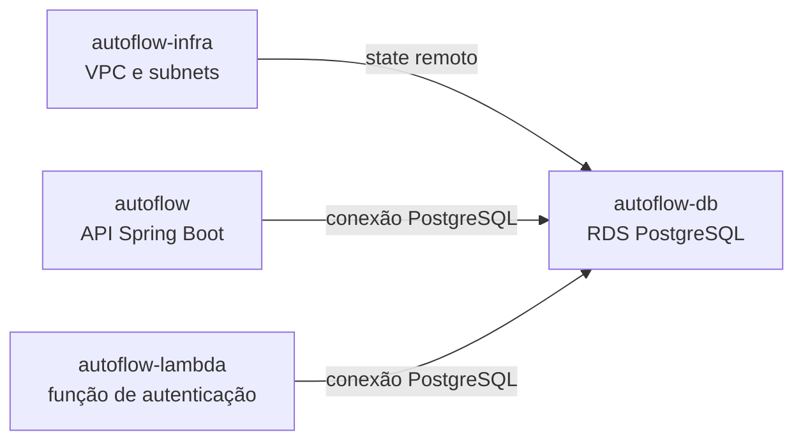

# AutoFlow — Infraestrutura do RDS

Este repositório declara recursos Terraform para o PostgreSQL gerenciado do AutoFlow na AWS. O código é configuração desejada e não comprova que o RDS ou os recursos de rede estejam implantados.

## Responsabilidade e dependências

O root `infra/` declara uma instância Amazon RDS PostgreSQL 17, subnet group e Security Groups. Ele consome saídas do state Terraform da infraestrutura compartilhada, mantida em `autoflow-infra`. A aplicação Spring Boot e a Lambda usam o banco conforme suas configurações.



O diagrama representa dependências declaradas, não conectividade ou implantação confirmada.

## Configuração Terraform observada

| Propriedade | Valor declarado |
|---|---|
| Engine e versão | PostgreSQL 17 |
| Classe | `db.t3.micro` |
| Armazenamento inicial | 20 GB |
| Nome do banco | `autoflow_db` |
| Porta | 5432 |
| Subnets | IDs privados lidos do state de `autoflow-infra` |
| Acesso público | `publicly_accessible = true` |
| Criptografia do storage | `storage_encrypted = false` |
| Snapshot final | Desativado (`skip_final_snapshot = true`) |
| Enhanced Monitoring | Desativado (`monitoring_interval = 0`) |

Esses são valores da configuração local. O atributo de acesso público e a ausência de criptografia são riscos de configuração que devem ser avaliados pelos responsáveis; não é possível inferir exposição real sem verificar recursos, rotas e Security Groups efetivos. A ausência de snapshot final pode eliminar a última cópia de recuperação quando o recurso for destruído.

## Estado e pré-requisitos

O root declara backend S3 por meio de `infra/backend.tf` e consome o state da infraestrutura em `infra/rds-postgresql.tf`. Antes de qualquer inicialização ou plano remoto, confirme bucket, key, responsabilidade e state autoritativo com os responsáveis. Não inicialize um state vazio sobre recursos que possam existir.

O bucket/key do backend são parâmetros externos, não arquivos de exemplo versionados. Para uso local, configure `AWS_PROFILE`, `AWS_REGION`, `AWS_EXPECTED_ACCOUNT_ID`, `TF_VAR_aws_profile`, `TF_VAR_aws_allowed_account_ids` (JSON de uma lista), `TF_VAR_terraform_state_bucket`, `TF_VAR_infra_state_key` e os inputs de banco por variáveis de ambiente locais ou por mecanismo seguro. Valide a identidade com `scripts/verify_aws_account.py` antes de acessar AWS. O `terraform init` recebe `-backend-config` para bucket, key, região, `encrypt=true` e `use_lockfile=true`.

O AWS Academy Learner Lab pode restringir operações por policies, boundaries, SCPs, contexto de `iam:PassRole`, quotas e duração da sessão. A saída `allowed`/`implicitDeny` de `simulate-principal-policy` é apenas uma simulação e **não garante autorização efetiva**. Inventários vazios também se limitam à conta, região e permissões consultadas. A readiness documentada para o perfil `fiap-lab` não autoriza deploy nem substitui confirmação do administrador/owner; consulte [readiness de homologação](../docs/specs/kong-gateway/09-homologacao-readiness.md).

## Comandos Terraform

Os comandos abaixo são referências de fluxo. Execute-os somente com state, conta, perfil AWS e autorização previamente confirmados:

```bash
terraform init -backend=false -input=false
terraform fmt -check -recursive
terraform validate
```

Para usar backend remoto, somente após reconciliar state, passe os parâmetros aprovados em `terraform init -reconfigure -backend-config=...`. `plan`/`apply` não fazem parte da validação estática; `apply` altera recursos AWS e exige autorização explícita e revisão do plano. `terraform destroy` pode remover o banco sem snapshot final conforme a configuração atual; não é um procedimento de rotina nem deve ser executado sem plano de recuperação aprovado.

## Fontes

- [`infra/rds-postgresql.tf`](infra/rds-postgresql.tf)
- [`infra/sg.tf`](infra/sg.tf)
- [`infra/backend.tf`](infra/backend.tf)
- [Visão geral dos quatro repositórios](../.agents/ai-context/02-repositories.md)
